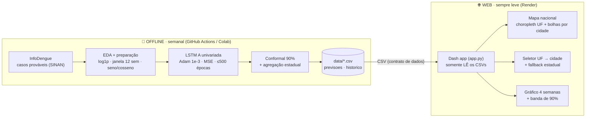
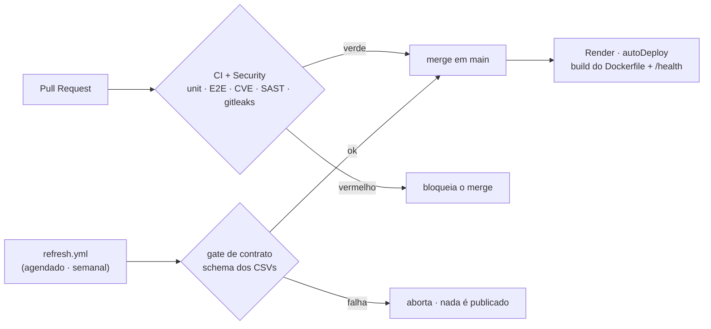

# Painel de previsão semanal de dengue — Brasil

[](https://github.com/fernando-aramis/dengue-lstm-forecast/actions/workflows/ci.yml)
[](https://github.com/fernando-aramis/dengue-lstm-forecast/actions/workflows/security.yml)
[](./LICENSE)
[](https://www.python.org/)
[](./render.yaml)

> **Resumo.** Painel web interativo de **previsão semanal de casos de dengue** para capitais e
> principais cidades do Brasil, **1 a 4 semanas à frente**, com **banda de incerteza conformal de
> 90%** e **fallback estadual** quando o município do usuário não tem modelo. A previsão usa uma
> rede **LSTM univariada** sobre a série de casos; o painel (**Dash + Plotly**) apenas *lê* os
> resultados já calculados. O trabalho estende ao **mapa nacional** o estudo *"Previsão semanal de
> casos de dengue em Curitiba com redes LSTM"* (IAGA04 — Aprendizado Profundo, Especialização em IA
> Generativa Aplicada, **UTFPR**, 2026). A página é um **artigo científico no padrão JBCS com o
> painel interativo embutido**: resumo da situação por nível, Figura 1 (mapa + detalhe com recência
> em Semana Epidemiológica, horizontes t+1…t+4 e Tabela 1 como alternativa textual ao mapa), seções
> numeradas, declarações, referências com DOI e "Como citar" (ABNT/BibTeX/CITATION.cff). Interface
> **trilíngue (PT/EN/ES)**, tema claro/escuro, fontes auto-hospedadas e contraste **WCAG 2.x AAA**.

O mapa tem **duas camadas**: um *choropleth* estadual (fundo, colorido pelo total previsto) e
**bolhas** por cidade (frente, pela cor do nível de alerta). Além do mapa, a página traz o
**contexto do estudo** (resumo, metodologia, resultados e limites) e segue a **identidade visual**
do projeto (paleta verde-terrosa + Inter), com foco visível e movimento discreto (respeita
`prefers-reduced-motion`).

> ✅ **Os dados em `data/*.csv` são REAIS** — gerados por `pipeline/gerar_previsoes_reais.py`
> (InfoDengue → EDA → LSTM A + conformal) para **33 cidades**, pipeline completo (até 500 épocas),
> origem na semana epidemiológica de **2026-10-25**. Os 33 geocodes foram **validados contra o
> IBGE**. O `data/br_uf.geojson` é a malha do IBGE **simplificada** (~128 KB).

---

## ⚠️ Aviso científico (disclaimer)

Este é um **projeto acadêmico/educacional**, **não** uma ferramenta oficial de vigilância
epidemiológica. O **nível de alerta exibido é uma simplificação** (faixas de incidência semanal por
100 mil habitantes) e **não corresponde ao alerta oficial do InfoDengue** nem a qualquer
recomendação de saúde pública. As previsões têm incerteza (ver a banda de 90%) e podem divergir do
observado. **Não use este painel para decisões clínicas, de política pública ou pessoais de saúde.**
Para informação oficial, consulte o [InfoDengue](https://info.dengue.mat.br/) e as autoridades de
saúde.

---

## Arquitetura

A regra central é a **"Opção 1"**: o **app web não treina e não re-prevê** — todo o custo de ML
fica *offline*, e o serving apenas lê CSVs já calculados. Isso mantém o deploy leve, barato e com
superfície de ataque mínima.



Nada é treinado no request → o deploy fica leve e grátis. O **schema** de `previsoes.csv` /
`historico.csv` é o **contrato** entre o pipeline e o app: troque os CSVs sem mudar o app.

## Modelo e metodologia

Fiel ao estudo original de Curitiba (decisões em `pipeline/`):

| Aspecto | Escolha | Observação |
|---|---|---|
| **Entrada → saída** | janela de **12 semanas** de casos → **4 semanas** à frente | multi-horizonte direto (`Dense(4)`) |
| **Arquitetura** | **LSTM A univariada** (só casos) | o clima causou sobreajuste no estudo; univariada foi a melhor |
| **Treino** | Adam (1e-3), perda **MSE**, `EarlyStopping` (paciência 30), **≤500 épocas**, seed 42 | reprodutível |
| **Features** | `log1p`, normalização Min-Max **só com o treino**, seno/cosseno da semana | iguais à planilha do estudo |
| **Série** | nowcast `casos_est` | corrige o atraso de notificação das semanas recentes |
| **Incerteza** | **predição conformal 90%** | quantil dos \|resíduos\| recentes (janela W=52) por horizonte; invertido por `expm1` |
| **Cobertura** | **33 cidades** + fallback estadual | UFs sem cidade monitorada aparecem em cinza neutro |

**Resultado reportado (estudo original, Curitiba).** A **LSTM A reduziu o erro em ~14%** no
horizonte de **4 semanas** dentro da faixa histórica (temporada 2022/23) frente à linha de base.
Este painel reusa essa metodologia para as demais cidades; as previsões nacionais são
**exploratórias** e herdam as limitações do estudo (ver *Aviso científico*).

## Rodar localmente

```bash
cd webapp
python3 -m venv .venv && source .venv/bin/activate
pip install -r requirements.txt

# os dados REAIS já estão em data/ — basta subir o app:
python app.py            # -> http://127.0.0.1:8050   (DASH_DEBUG=1 liga o modo debug)

# (opcional) instalação ENDURECIDA/reprodutível, com verificação de hash — idêntica à da imagem:
#   pip install --require-hashes -r requirements.lock
# (regere o lock quando requirements.txt mudar — ver o comando `uv pip compile` no Dockerfile)
```

## Estrutura

| Arquivo | Papel |
|---|---|
| `app.py` | App Dash: init, callbacks, cabeçalhos de segurança e gzip. Só **lê** `data/`. |
| `dados.py` | Carga de CSV/GeoJSON + globais derivados (cap do intervalo, `_meta.json`). |
| `figuras.py` | Figuras Plotly (mapa, detalhe) e cartão, com paleta por tema (claro/escuro). |
| `layout.py` | Blocos editoriais, barra de controles (idioma/tema) e montagem da página. |
| `i18n.py` | Traduções PT/EN/ES da interface (detecção por `Accept-Language`, fallback EN). |
| `assets/style.css` | Identidade visual (paleta + Inter), temas claro/escuro, responsivo e acessível (AAA). |
| `data/previsoes.csv` · `data/historico.csv` | Previsão t+1..t+4 + banda 90% (cidade **e** estado) · casos observados. |
| `data/_meta.json` · `data/snapshots/` | Proveniência (coleta, modelo, origem) · snapshots datados (backtesting). |
| `data/br_uf.geojson` | Malha das 27 UFs (IBGE, **simplificada** ~128 KB; chave `properties.sigla`). |
| `pipeline/infodengue.py` | Coleta a série semanal real (API alertcity) + **validação de schema**. |
| `pipeline/preparacao.py` · `pipeline/modelo.py` | EDA/preparação (19 etapas) · LSTM A + conformal 90%. |
| `pipeline/gerar_previsoes_reais.py` | **Pipeline completo**: InfoDengue → EDA → modelo → CSVs + `_meta.json` + snapshot. |
| `pipeline/simplificar_geojson.py` | Simplifica a geometria da malha (offline, shapely) p/ reduzir o payload do mapa. |
| `pipeline/validar_geocodes.py` | Confere os geocodes de `cidades.py` contra o IBGE (33/33 OK). |
| `tests/test_unit.py` · `tests/test_e2e.py` | Validação (AAA claro/escuro, contrato, _meta, geojson, segurança) · Playwright (5 breakpoints, idioma/tema). |
| `.github/workflows/` | `ci` (testes), `security` (CVE/SAST/imagem/segredos) e `refresh` (pipeline semanal). |

## Testes

```bash
cd webapp && source .venv/bin/activate
pip install -r tests/requirements.txt
python -m playwright install chromium     # 1ª vez (navegador do E2E)
pytest tests/ -q                          # 32 testes: 19 unit (validação) + 13 E2E (Playwright)
```

As prévias ficam em `tests/screenshots/` (`bp-*` por breakpoint; `dark-*` no tema escuro). O schema
de `previsoes.csv` / `historico.csv` é o **contrato** entre o pipeline e o app: mantenha as colunas
e o app não muda.

## CI/CD e deploy

**GitHub Flow** com três workflows (`.github/workflows/`): `ci` (unit em Python 3.11/3.14 + E2E),
`security` (pip-audit · bandit · hadolint · Trivy · **gitleaks no histórico**) e `refresh`
(pipeline semanal com **gate de contrato** antes de commitar). Actions **SHA-pinned**; Dependabot
mantém os updates. O deploy é no **Render** (Docker, free tier) via `render.yaml` — **auto-deploy no
push em `main`** (não há workflow de deploy: o Render observa o repositório).



### Publicar no Render

1. Em [render.com](https://render.com), faça *Sign up with GitHub* e autorize o repositório.
2. **New → Blueprint** → selecione este repo. O Render lê o `render.yaml`, builda o `Dockerfile` e
   publica o web service (monitorando `/health`).
3. Deploy automático a cada push em `main`. Em *Settings* dá para exigir **"After CI Checks Pass"**.
4. Para atualizar a previsão: rode o pipeline (ou o workflow `refresh.yml`) e faça commit dos novos
   `data/*.csv` — o push redispara o deploy.

> A imagem é portável: Render, Fly.io, Koyeb etc. servem o mesmo `Dockerfile` (ou `gunicorn
> app:server`). O container roda como usuário **não-root**, com `HEALTHCHECK` e dependências
> **hash-pinned**.

## Operação / produção

- **Variáveis de ambiente:** `DASH_DEBUG=1` liga o debug (padrão **desligado** — nunca em produção),
  `HOST`/`PORT` (padrão `127.0.0.1:8050`), `WEB_CONCURRENCY` (workers do gunicorn), `LOG_LEVEL`.
- **Segurança (hardening de exposição):** cabeçalhos `X-Content-Type-Options`, `Referrer-Policy`,
  `X-Frame-Options`, HSTS, `Permissions-Policy` e uma **CSP em Report-Only** — mantida assim por
  **decisão documentada**: o renderer do Dash exige `script-src 'unsafe-inline' 'unsafe-eval'` e os
  mapas (MapLibre) exigem `worker-src blob:`, então enforçar agregaria pouco (ver a docstring de
  `_cabecalhos_seguranca` em `app.py`). Sem auth/DB/PII por design.
- **Desempenho:** respostas com **gzip** (flask-compress) e geojson simplificado; o tema recolore o
  mapa via `Patch` parcial, **sem reenviar** o geojson.

## Pipeline real (reproduzir a previsão)

```bash
cd webapp && source .venv/bin/activate
pip install -r pipeline/requirements.txt
cd pipeline
CIDADES_GEO=4106902 MODO_RAPIDO=1 python gerar_previsoes_reais.py   # smoke numa cidade
python gerar_previsoes_reais.py                                      # todas (lento em CPU; ideal GPU)
```

Isso sobrescreve `data/historico.csv` e `data/previsoes.csv` com previsões **reais** e grava
`data/eda.json`. O app passa a mostrar a previsão nova **sem nenhuma mudança de código**.

## Como citar

Se este software ou seus resultados forem úteis, cite-o. O GitHub renderiza *"Cite this
repository"* a partir do `CITATION.cff`. Em BibTeX:

```bibtex
@software{colque_dengue_lstm_2026,
  author  = {Colque, Fernando Aramis},
  title   = {Painel de previsão semanal de dengue no Brasil (LSTM + predição conformal)},
  year    = {2026},
  version = {1.0.0},
  license = {GPL-3.0-or-later},
  url     = {https://github.com/fernando-aramis/dengue-lstm-forecast}
}
```

## Licença

Código distribuído sob a **GNU General Public License v3.0** — ver [`LICENSE`](./LICENSE).
Copyright © 2026 Fernando Aramis Colque.

Os **dados** seguem os termos de suas fontes: casos via **InfoDengue** (SINAN), clima **ERA5** via
**Mosqlimate** (Coelho et al., 2024 — Infodengue-Mosqlimate Sprint 2024, Zenodo
[10.5281/zenodo.13328231](https://doi.org/10.5281/zenodo.13328231)) e malha estadual do **IBGE**.

## Créditos e referências

**Autor:** Fernando Aramis Colque — IAGA04 (Aprendizado Profundo), Especialização em IA Generativa
Aplicada, **UTFPR** (2026). O painel estende ao mapa nacional o estudo *"Previsão semanal de casos
de dengue em Curitiba com redes LSTM"*.

**Referências:** Araujo et al. (2026, PNAS); Chen & Moraga (2025, BMC Public Health); Mussumeci &
Coelho (2020); Hochreiter & Schmidhuber (1997).

> 🤖 **Co-autoria e validação com IA:** este projeto foi desenvolvido com a colaboração do
> **[Claude Code](https://claude.com/claude-code) (Anthropic)** — planejamento, revisão de código,
> testes, acessibilidade (WCAG 2.x AAA / 3.0 APCA), hardening de segurança e CI/CD. A revisão e as
> decisões finais são do autor.
